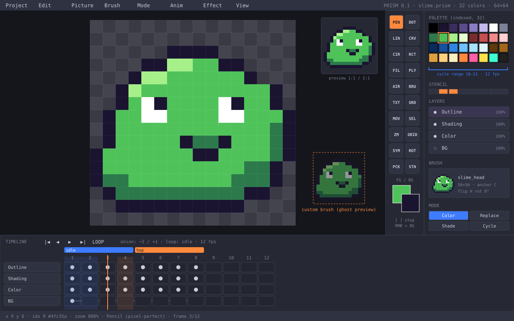
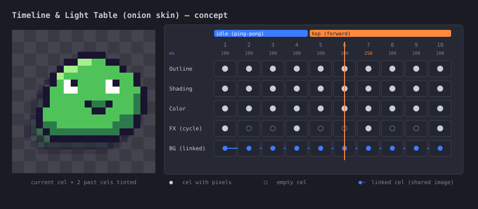
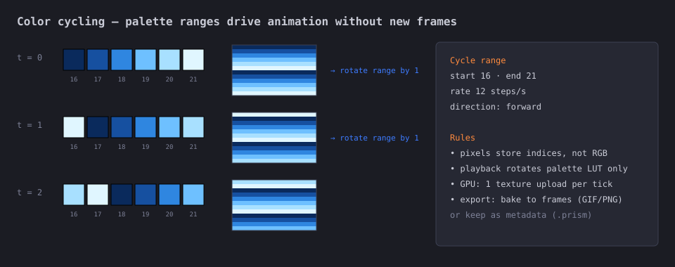
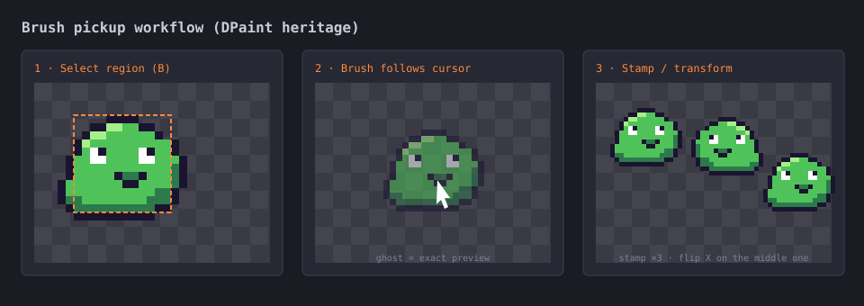
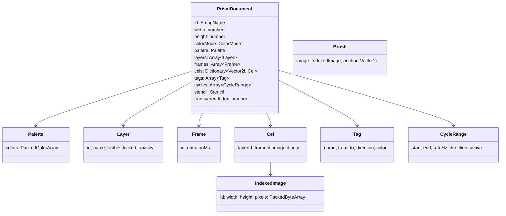
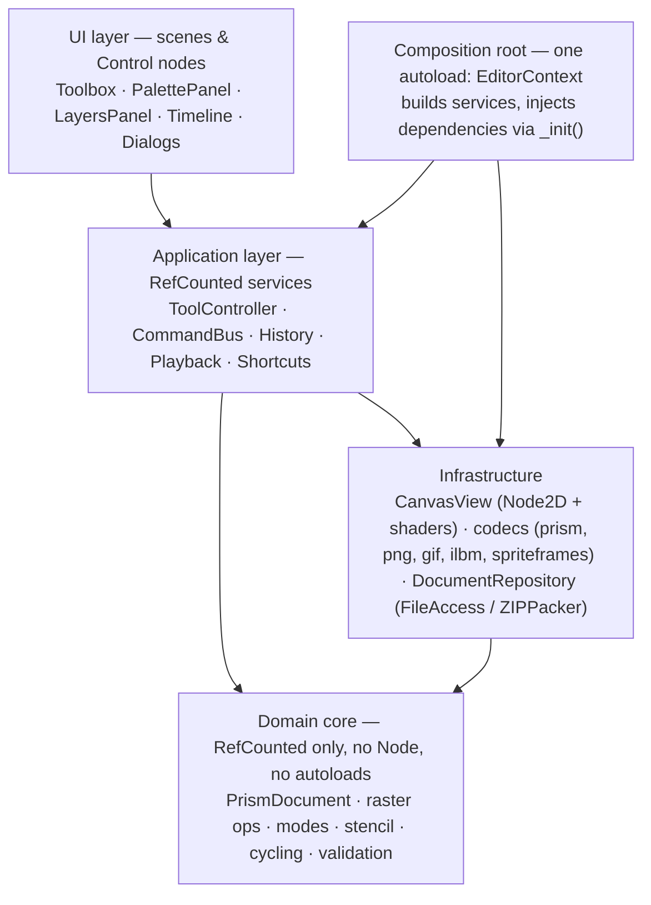
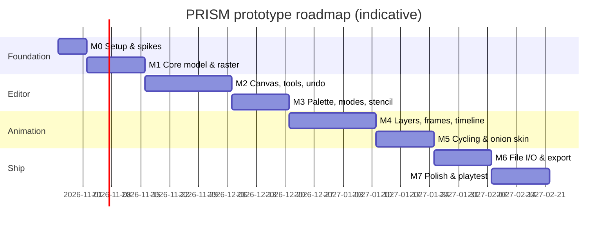

# PRISM — Pixel Art & Animation Editor
### Prototype Design Document (GDD) · v0.1

| Field | Value |
|---|---|
| Project codename | **PRISM** (a nod to *Prism*, the in-house EA tool that became Deluxe Paint) |
| Document type | Prototype-focused design document + implementation roadmap |
| Version | 0.2 — Draft (retargeted to Godot 4.7) |
| Date | 2026-10-19 |
| Author | Walter Palladino |
| Status | For review |
| Target | Desktop pixel-art painting & frame animation tool built as a **Godot 4.7 application** (Windows, macOS, Linux; web export optional) |
| Language | GDScript, fully statically typed (no `:=` inference, no untyped `var`, no `Variant` in signatures); GDExtension (C++) only where profiling demands it |

**Changelog**

| Version | Change |
|---|---|
| 0.2 | Engine changed from TypeScript/WebGL to **Godot 4.7**. Rewrote §6.2 (data contracts), §9 (architecture), §10 milestones M0/M2/M6, §11 (testing) and §12 (risks); adjusted §5 and §7.12 for Godot-native export (`SpriteFrames`). |
| 0.1 | Initial draft. |

> **Naming note.** The classic Amiga program is officially **Deluxe Paint** (often "DPaint"), not "Paint Deluxe". This document uses *Deluxe Paint / DPaint* throughout.

---

## Table of Contents

1. [Vision](#1-vision)
2. [Inspirations & Reference Images](#2-inspirations--reference-images)
3. [Design Pillars](#3-design-pillars)
4. [Target Users & Core Use Cases](#4-target-users--core-use-cases)
5. [Prototype Scope](#5-prototype-scope)
6. [Core Concepts & Data Model](#6-core-concepts--data-model)
7. [Feature Specification](#7-feature-specification)
8. [UX & UI](#8-ux--ui)
9. [Technical Architecture](#9-technical-architecture)
10. [Implementation Roadmap](#10-implementation-roadmap)
11. [Testing & Quality Strategy](#11-testing--quality-strategy)
12. [Risks & Open Questions](#12-risks--open-questions)
13. [Prototype Success Criteria](#13-prototype-success-criteria)
14. [Appendix A — Glossary](#appendix-a--glossary)
15. [Appendix B — Credits, Sources & Image Attribution](#appendix-b--credits-sources--image-attribution)

---

## 1. Vision

**PRISM is a palette-first pixel painter with a modern animation timeline.**

It takes the *immediacy* of Deluxe Paint — pick up any region as a brush, paint with drawing *modes*, protect colors with a stencil, animate by cycling the palette — and combines it with the *structure* of Aseprite — layers and frames as separate axes, cels, tags, onion skin, sprite-sheet export.

**Elevator pitch:** *"DPaint's hands, Aseprite's timeline."*

### 1.1 What makes it different

| From Deluxe Paint | From Aseprite | PRISM's own angle |
|---|---|---|
| Brush pickup as a first-class workflow (any region becomes the pen) | Layers × frames grid with cels and linked cels | Indexed color is the **default**, not an option |
| Drawing *modes* (Color, Replace, Shade, Smear, Cycle) | Animation tags with direction (forward / reverse / ping-pong) | Palette cycling is part of the timeline and can be baked to frames on export |
| Stencil (lock palette indices from being painted over) | Onion skin with past/future ranges | Brushes can be *anim-brushes* that advance per stamp/frame |
| Two-handed palette stepping (`[` / `]`) and right-button background color | Pixel-perfect freehand, symmetry, tiled mode | Clean, typed, tested core usable headless (`godot --headless` for CLI/automation) |
| — | Sprite sheet + JSON export | **Direct export to Godot `SpriteFrames` (`.tres`)** — art goes from PRISM into a Godot game with no importer plugin |

---

## 2. Inspirations & Reference Images

### 2.1 Original references (third-party — linked, not embedded)

Screenshots of Deluxe Paint and Aseprite are copyrighted by their respective owners and are generally **not** under free licenses. To keep this document redistributable, original references are **linked to their hosting pages with attribution** rather than copied into the repository. Do not commit third-party screenshots to the repo unless the license is verified (see [Appendix B](#appendix-b--credits-sources--image-attribution)).

| # | Reference | What to study | Where to view | Credit / rights |
|---|---|---|---|---|
| R1 | **Deluxe Paint V** on the Amiga (infobox screenshot, sample image *The Birth of Venus* detail) | Right-side toolbox, palette strip, full-bleed canvas, minimal chrome | [Wikipedia — Deluxe Paint](https://en.wikipedia.org/wiki/Deluxe_Paint) | © Electronic Arts. Used on Wikipedia under its own terms; check the file page before reuse |
| R2 | **Deluxe Paint I** splash screen & floppy disk photo | Era branding, product framing | [Computer History Museum — DeluxePaint Early Source Code](https://computerhistory.org/blog/electronic-arts-deluxepaint-early-source-code/) | Article by Leonard J. Shustek (CHM, 2015). Disk photo credited by CHM to Blake Patterson via Wikimedia Commons |
| R3 | **Deluxe Paint Animation** (MS-DOS, 1990) | 320×200 / 256-color animation workflow, VGA palette | [Wikipedia — Deluxe Paint Animation](https://en.wikipedia.org/wiki/Deluxe_Paint_Animation) | © Electronic Arts |
| R4 | **DeluxePaint manuals** (I, II, III, IV) | Exact behavior of modes, stencils, color cycling, light table, animbrushes | [DPaint I manual (GitHub, historicalsource)](https://github.com/historicalsource/DeluxePaint/blob/master/DeluxePaint_I_manual.pdf) · [DPaint III manual (Internet Archive)](https://archive.org/details/DeluxePaint3Manual) · [DPaint IV manual (Internet Archive)](https://archive.org/details/DeluxePaintIVManualENG) | © Electronic Arts. Reference only |
| R5 | **Aseprite** main editor screenshot | Timeline grid, layer panel, tags, preview window, color bar | [Wikipedia — Aseprite](https://en.wikipedia.org/wiki/Aseprite) · [aseprite.org](https://www.aseprite.org/) | © Igara Studio S.A. Proprietary, source-available under EULA |
| R6 | **Aseprite feature list** | Layers/frames as separate concepts, onion skin, tilemaps, Lua, CLI | [github.com/aseprite/aseprite](https://github.com/aseprite/aseprite) | © Igara Studio S.A. and contributors |
| R7 | **DPaint JS** (open-source web DPaint homage) | Prior art for Amiga file formats (IFF) and DPaint behavior | [AlternativeTo — DPaint JS](https://alternativeto.net/software/dpaint-js/about) | By Steffest, MIT license |
| R8 | **PyDPainter** (open-source DPaint resurrection) | Prior art for modern DPaint-faithful UX | [Blender Artists thread](https://blenderartists.org/t/pydpainter-a-free-resurrection-of-the-classic-dpaint-pixel-editor/1598518) | Open-source project, see its repository for license |
| R9 | **Pixelorama** (open-source pixel editor built with Godot) | Closest technical precedent: a full sprite editor shipped as a Godot app — study its canvas, timeline and export performance | [github.com/Orama-Interactive/Pixelorama](https://github.com/Orama-Interactive/Pixelorama) | By Orama Interactive and contributors; check the repository's LICENSE before reusing any code and keep attribution if you do |

#### Historical facts that inform the design

- Deluxe Paint was created by **Dan Silva** for Electronic Arts and shipped for the Amiga 1000 in **November 1985**; it began as an internal art tool called *Prism*.
- **DPaint I** featured animation by **color cycling** of indexed palettes.
- **DPaint II** (1986) added pattern/gradient fills and an effects menu with perspective.
- **DPaint III** (1989) added **stencils**, cel-style **animation** and **animbrushes**.
- **DPaint IV** (1991) added HAM support, a **light table** (onion skin) and animbrush morphing.
- EA introduced the **IFF ILBM** and **ANIM** formats with DPaint; ANIM is delta-compressed.
- In 2015 EA released the DPaint I source under a non-commercial license via the Computer History Museum.
- Aseprite (formerly *Allegro Sprite Editor*) started in **2001** under GPLv2 and switched to a proprietary EULA in **2016** (v1.1.8 was the last GPL release); **LibreSprite** forked from the GPL code. It is developed by Igara Studio S.A. (David, Gaspar and Martín Capello).

> **Clean-room rule.** PRISM must not copy code from Aseprite (EULA) or the DPaint source release (non-commercial license). Behavior is reimplemented from public manuals, documentation and observation. LibreSprite (GPLv2) code is also off-limits unless the project chooses GPL.

### 2.2 New concept art (original, project-owned)

All concept art below was created for this document, is owned by the project, and may be freely modified. Sources are SVG files in `concept-art/` and are regenerated by `tools/gen_concepts.py`.

#### C1 — Main editor layout


*C1. Canvas center-left with a 16×16 sprite at 800%. DPaint-style toolbox on the right edge with FG/BG swatches. Side panel: indexed palette with a color-cycle range bracket, stencil toggles, layers, the current custom brush and drawing mode. Bottom: timeline with tags (`idle`, `hop`), cels, a linked BG layer, onion-skin ranges (blue = past, orange = future) and playhead. Original concept art, PRISM project.*

#### C2 — Timeline & light table


*C2. Left: onion skin ("light table") showing the current cel with two past cels at reduced opacity. Right: timeline grid — per-frame duration row (frame 7 held at 250 ms), tags with direction, empty cels (○), linked cels sharing one image (blue). Original concept art, PRISM project.*

#### C3 — Color cycling


*C3. A six-entry palette range rotates one step per tick; the waterfall pixels never change, only the lookup table does. Original concept art, PRISM project.*

#### C4 — Brush pickup workflow


*C4. DPaint-heritage brush flow: (1) box-select a region with `B`, (2) the brush rides the cursor as an exact ghost preview, (3) stamp repeatedly, optionally flipped/rotated. Original concept art, PRISM project.*

---

## 3. Design Pillars

1. **Pixels are indices.** The palette is the source of truth. Recoloring, shading ramps, stencils and cycling all fall out of that one decision.
2. **The brush is the cursor.** Whatever you will paint is what you see under the mouse, at exact pixel positions — tools, custom brushes and anim-brushes alike.
3. **Two hands, zero dialogs.** Every frequent action is reachable by keyboard + mouse without opening a modal.
4. **Animation is a grid.** Layers (vertical) × frames (horizontal) = cels. Tags slice frames into named clips.
5. **Deterministic core.** The document model and every operation are pure, typed and testable without a UI. The UI is a thin adapter.

---

## 4. Target Users & Core Use Cases

| Persona | Need | Prototype must support |
|---|---|---|
| **Indie game dev** (primary) | Sprites and short loops for a 2D game (Godot, Unity, web) | Indexed sprites, frame animation, tags, sprite sheet + JSON export |
| **Retro / demoscene artist** | Amiga/VGA-style art with strict palettes | Palette editing, ramps, stencil, color cycling, 320×200-class canvases |
| **Hobbyist animator** | Short GIF loops for social posts | Onion skin, playback, GIF export |

**Core loops**

- *Paint loop:* pick color/brush → paint with mode → step palette with `[ ]` → undo/redo → repeat.
- *Animate loop:* add frame → onion skin on → redraw cel → play tag → adjust frame duration.
- *Ship loop:* save `.prism` → export PNG / sprite sheet + JSON / GIF.

---

## 5. Prototype Scope

The prototype proves the **core loops** end-to-end at good quality. It is not a full product.

### 5.1 In scope (P0 — must ship in prototype)

- Single document, canvas up to 512×512, indexed mode with up to 256 colors
- Tools: Pencil (with pixel-perfect), Eraser, Line, Rectangle (outline/filled), Ellipse (outline/filled), Flood fill (contiguous / global), Color picker, Rectangle select, Move, Brush pickup (box)
- Built-in brushes: 1–8 px square/round; custom brushes from pickup with flip H/V and 90° rotation
- Drawing modes: **Color**, **Replace** (respects alpha), **Shade** (step ±1 along palette ramp)
- Palette: edit entries (RGB), load/save `.gpl` and `.hex`, `[` / `]` stepping, right-button = BG color
- Stencil: lock up to N palette indices from being overwritten
- Layers: add/remove/rename/reorder, visibility, lock, opacity (display-only in indexed mode)
- Frames: add/duplicate/delete/reorder, per-frame duration, linked cels
- Tags: name, frame range, direction (forward/reverse/ping-pong), color
- Onion skin: past/future count, tint, opacity
- Playback of current tag or whole timeline
- Color cycling: up to 4 ranges, rate, direction; preview in playback
- Undo/redo for every document mutation (≥ 200 steps)
- Zoom (100–3200%), pan, pixel grid, checkerboard
- File: native `.prism` save/load; PNG import/export (single frame); PNG sequence; sprite sheet PNG + JSON; **Godot `SpriteFrames` `.tres` + sheet**; GIF export (with optional cycling bake)
- Native OS file dialogs (`FileDialog.use_native_dialog`)
- Autosave/crash recovery

### 5.2 Stretch (P1 — if time allows)

- Smear and Cycle drawing modes
- Anim-brushes (multi-frame brush that advances per stamp)
- Lasso/polygon selection & brush pickup
- Symmetry (H/V) and tiled-wrap mode
- IFF ILBM import (single image)
- RGBA document mode
- Pen pressure (Godot exposes it on `InputEventMouseMotion.pressure`, so the cost is mostly UX design)

### 5.3 Out of scope (post-prototype)

Tilemaps, scripting (Lua/JS), CLI batch export, HAM modes, perspective/3D brush transforms, text tool, plugin system, collaborative editing, `.aseprite` import, IFF ANIM export, mobile/touch UI.

---

## 6. Core Concepts & Data Model

### 6.1 Entity overview



### 6.2 GDScript contracts (static typing enforced)

All domain classes extend `RefCounted` — **never `Node`** — so they run in unit tests and headless tools without a scene tree. Keys in `cels` are `Vector2i(layer_index, frame_index)`; typed dictionaries are available since Godot 4.4.

**Typing is enforced by the project, not by convention.** In `project.godot`, set these GDScript warnings to **Error**: `untyped_declaration`, `inferred_declaration` (bans `:=`), `unsafe_property_access`, `unsafe_method_access`, `unsafe_cast`, `unsafe_call_argument`, `return_value_discarded`. Confirm the exact setting names in the 4.7 Project Settings → Debug → GDScript panel when creating the project.

```gdscript
# res://core/model/enums.gd
class_name PrismEnums
extends RefCounted

enum ColorMode { INDEXED, RGBA }
enum TagDirection { FORWARD, REVERSE, PING_PONG }
enum DrawMode { COLOR, REPLACE, SHADE, SMEAR, CYCLE }
```

```gdscript
# res://core/model/indexed_image.gd
class_name IndexedImage
extends RefCounted

var id: StringName
var width: int
var height: int
## One palette index per pixel, row-major. PackedByteArray is copy-on-write:
## mutate it only through this object, never through a copy held elsewhere.
var pixels: PackedByteArray


func _init(p_id: StringName, p_width: int, p_height: int) -> void:
	id = p_id
	width = p_width
	height = p_height
	pixels = PackedByteArray()
	var resize_error: int = pixels.resize(width * height)
	assert(resize_error == OK)


func get_index(x: int, y: int) -> int:
	return pixels[y * width + x]


func set_index(x: int, y: int, value: int) -> void:
	pixels[y * width + x] = value
```

```gdscript
# res://core/model/cel.gd
class_name Cel
extends RefCounted

var layer_id: StringName
var frame_id: StringName
var image_id: StringName   # shared image_id == linked cel
var offset: Vector2i
```

```gdscript
# res://core/model/tag.gd
class_name Tag
extends RefCounted

var tag_name: String
var from_frame: int
var to_frame: int
var direction: PrismEnums.TagDirection
var color: Color
```

```gdscript
# res://core/model/cycle_range.gd
class_name CycleRange
extends RefCounted

var start_index: int   # inclusive
var end_index: int     # inclusive
var rate_hz: float     # steps per second
var step: int          # +1 forward, -1 reverse
var active: bool
```

```gdscript
# res://core/model/stencil.gd
class_name Stencil
extends RefCounted

## 256 flags, 1 = locked. A PackedByteArray lookup is faster than a Dictionary in hot loops.
var locked: PackedByteArray


func _init() -> void:
	locked = PackedByteArray()
	var resize_error: int = locked.resize(256)
	assert(resize_error == OK)


func is_locked(index: int) -> bool:
	return locked[index] == 1
```

```gdscript
# res://core/model/prism_document.gd
class_name PrismDocument
extends RefCounted

var id: StringName
var width: int
var height: int
var color_mode: PrismEnums.ColorMode = PrismEnums.ColorMode.INDEXED
var palette: Palette
var transparent_index: int = 0
var layers: Array[Layer] = []
var frames: Array[Frame] = []
var images: Dictionary[StringName, IndexedImage] = {}
var cels: Dictionary[Vector2i, Cel] = {}
var tags: Array[Tag] = []
var cycles: Array[CycleRange] = []
var stencil: Stencil = Stencil.new()
```

### 6.3 Invariants

- `pixels.size() == width * height`; values are in `[0, palette.colors.size())`.
- `transparentIndex` is never written by **Color** mode when painting with the BG button unless the BG color *is* the transparent index (DPaint semantics: right button paints with BG).
- Stencil-locked indices are never overwritten by any paint operation; they can still be changed by palette edits.
- A linked cel edit mutates the shared image; unlinking clones it (copy-on-write).
- Cycle ranges never overlap in the prototype (validation error on create).

---

## 7. Feature Specification

Priority: **P0** = prototype, **P1** = stretch, **P2** = later.

### 7.1 Canvas & view (P0)

| Feature | Behavior | Acceptance |
|---|---|---|
| Zoom | Integer steps 1×–32×, zoom toward cursor; `+`/`-`, wheel | No sub-pixel blur at any zoom (nearest-neighbor only) |
| Pan | Space+drag, middle mouse | 60 fps on 512×512 |
| Grid | Pixel grid auto-shown ≥ 600%; optional custom grid (e.g. 16×16 tiles) | Toggle `G` |
| Preview window | Floating 1×/2× preview of current frame, plays independently | Matches C1 |
| Checkerboard | Shows transparency index | Configurable colors |

### 7.2 Tools (P0 unless marked)

| Tool | Key | Notes |
|---|---|---|
| Pencil | `D` | Freehand with Bresenham interpolation between pointer events. **Pixel-perfect** toggle removes L-shaped corners. |
| Eraser | `E` | Paints transparent index; respects stencil |
| Line | `L` | Shift constrains to 0/45/90° and "pixel-art angles" (1:2, 2:1) |
| Rectangle | `R` | Outline / filled (`Shift+R`) |
| Ellipse | `O` | Outline / filled; midpoint algorithm, symmetric pixels |
| Fill | `F` | Contiguous (4-way) / global replace (`Shift+F`); respects stencil |
| Picker | `I` / `Alt`-hold | LMB → FG, RMB → BG |
| Rect select | `M` | Marching ants; copy/cut/paste; move with arrows |
| Brush pickup | `B` | Box region → becomes current brush; transparent index is see-through (C4) |
| Move cel | `V` | Moves cel offset |
| Lasso pickup | — | **P1** |
| Symmetry | — | **P1** |
| Airbrush, curve, polygon, text | — | P2 |

**Input rules (all paint tools)**

- LMB paints with **FG**, RMB paints with **BG** (DPaint heritage).
- The active brush (built-in or custom) is drawn as a **ghost preview** under the cursor at the exact snapped pixel position.
- `[` / `]` step FG index −1/+1; `{` / `}` step BG.
- `Esc` cancels any in-progress shape; a cancelled stroke leaves no undo entry.

### 7.3 Drawing modes ("inks")

| Mode | Priority | Rule per destination pixel `d` with brush pixel `s` |
|---|---|---|
| Color | P0 | Brush shape painted in solid FG/BG index (custom brush acts as a mask) |
| Replace | P0 | Custom brush pixels copied as-is; brush transparent index skipped |
| Shade | P0 | `d = clamp(d ± 1)` within the **ramp** containing `d` (ramp = contiguous palette span defined by user); LMB = +1, RMB = −1 |
| Smear | P1 | Drags the pixels under the brush along the stroke |
| Cycle | P1 | Each stamp advances the FG index through the active cycle range |

Modes compose with **stencil**: after computing the new value, the write is skipped if the *destination's current index* is locked.

### 7.4 Palette & color (P0)

- Default palette: 32-color project palette (see C1). Additional presets: PICO-8-style 16, EGA 16, grayscale ramp.
- Palette editor: RGB/HSV sliders, hex entry, drag to reorder **with remap** (pixels follow their color) or **without remap** (pixels keep indices).
- **Ramps:** user marks contiguous spans as shading ramps (used by Shade mode).
- Import/export: GIMP `.gpl`, `.hex`, PNG strip. P1: extract palette from imported PNG (≤ 256 colors) or quantize.

### 7.5 Stencil (P0)

- Toggle a palette index as locked via `Ctrl+click` on its swatch or the stencil row (C1).
- "Invert stencil" and "Lock all except FG" quick actions.
- Visual: locked swatches show an orange underline.

### 7.6 Color cycling (P0)

- Up to 4 non-overlapping ranges; each has start, end, rate (steps/s), direction, active flag.
- Toggle cycling preview with `Tab` (DPaint used Tab for the same purpose).
- Cycling runs during timeline playback and in the preview window.
- **Export:** GIF/PNG-sequence can *bake* cycling into frames (LCM of cycle periods, capped by a user limit), or keep cycling as metadata in `.prism` only.

### 7.7 Layers (P0)

Add, delete, duplicate, rename, reorder (drag), visibility, lock, display opacity. Layer groups are **P2**. Reference layer (non-exported, any image, for rotoscoping) is **P1**.

### 7.8 Frames, cels & timeline (P0)

- Grid of layers × frames (C1, C2). Click a cel to edit it.
- Frame ops: insert empty, duplicate (deep or linked), delete, drag-reorder, set duration (ms) for one or many frames.
- Cel ops: link/unlink, clear, copy/paste across frames.
- Tags: create from frame selection, edit name/color/direction; looping playback of active tag.
- Keyboard: `,` / `.` previous/next frame, `Enter` play/stop, `Alt+N` new frame, `Alt+D` duplicate.

### 7.9 Onion skin / light table (P0)

- Past and future counts (0–5 each), separate tints (default blue past, orange future), opacity falloff.
- Mode: *tag-bounded* (don't show frames outside the current tag) or *global*.
- Hidden automatically during playback.

### 7.10 Anim-brushes (P1)

Pick up the same region across N frames → brush with N images. Each stamp (or each frame while painting across frames) advances the brush frame. Matches the DPaint III idea of an "animbrush".

### 7.11 Undo / redo (P0)

- Command pattern; every mutation is a `Command` with `apply` / `revert`.
- Pixel commands store **dirty-rect diffs** (before/after bytes of the bounding box), not full images.
- Stroke = one command (coalesced pointer events).
- History limit by memory budget (default 256 MB) and count (default 500).

### 7.12 File I/O

| Format | Dir | Priority | Notes |
|---|---|---|---|
| `.prism` | R/W | P0 | Zip container written with `ZIPPacker` / read with `ZIPReader`: `document.json` (model, versioned schema) + `images/*.bin` (raw indices) |
| PNG (single) | R/W | P0 | RGBA via `Image.save_png()` / `Image.load_png_from_buffer()`. Godot cannot write **indexed** PNG; a small custom encoder (PLTE + tRNS, zlib-wrapped deflate, CRC32) is **P1** |
| PNG sequence | W | P0 | `name_0001.png`… |
| Sprite sheet + JSON | W | P0 | Packing: row, column, grid, or tight; JSON lists frames, durations, tags |
| Godot `SpriteFrames` | W | P0 | Writes `sheet.png` + a text `.tres` with one animation per tag (`AtlasTexture` regions, per-frame duration relative to the tag's base FPS, loop on/off). User chooses the target Godot project folder so `res://` paths resolve |
| GIF | W | P0 | Godot has no GIF encoder: custom GDScript LZW encoder; move to GDExtension if the M0 spike misses budget. Per-frame delays, global palette, transparency index; optional cycle bake |
| IFF ILBM | R | P1 | Single image, BMHD/CMAP/BODY, ByteRun1 decompression |
| IFF ANIM | W | P2 | Delta-compressed export for retro pipelines |
| `.aseprite` | R | P2 | Only via the publicly documented file spec; verify license terms first |

### 7.13 Preferences (P0, minimal)

Theme (dark/light, as Godot `Theme` resources), checkerboard colors, onion tints, autosave interval, UI scale. Key bindings are `InputMap` actions, defaults defined in `project.godot`, user overrides saved to `user://keybindings.json` and applied at startup. Settings persist with `ConfigFile` at `user://settings.cfg`.

---

## 8. UX & UI

### 8.1 Layout

See **C1**. Regions:

1. **Menu bar** — Project, Edit, Picture, Brush, Mode, Anim, Effect, View (menu names echo DPaint's structure).
2. **Canvas** — dominant area; preview window floats top-right.
3. **Toolbox** — right edge, 2-column icon grid, FG/BG swatch block below (DPaint placement).
4. **Side panel** — palette (+ cycle brackets), stencil row, layers, current brush, drawing mode.
5. **Timeline** — bottom dock, collapsible (`Ctrl+T`).
6. **Status bar** — cursor position, palette index + hex under cursor, zoom, tool, frame.

### 8.2 Visual style

- **Modern dark theme** by default (deep slate `#1b1c23`, panels `#262833`), with two Amiga-era accents: Workbench-style **blue `#3d7bff`** for "past"/selection and **orange `#ff8a3d`** for "active"/future.
- Optional **"Workbench" skin** (P2): flat blue/orange/white/black with beveled buttons as a nostalgia mode.
- UI scale independent of canvas zoom; crisp 1px borders; monospace UI font for numbers.

### 8.3 Default key map (prototype)

| Action | Key | Heritage |
|---|---|---|
| Pencil / Eraser / Line / Rect / Ellipse / Fill | `D` `E` `L` `R` `O` `F` | — |
| Brush pickup | `B` | DPaint |
| Restore built-in brush | `.` on numpad / `Shift+B` | DPaint |
| Flip brush H / V | `X` / `Y` | DPaint |
| Rotate brush 90° | `Z` | DPaint |
| FG index −1 / +1 | `[` / `]` | DPaint |
| Toggle color cycling | `Tab` | DPaint |
| Stencil panel | `~` | — |
| Prev / next frame | `,` / `.` | Aseprite-like |
| Play / stop | `Enter` | Aseprite-like |
| Onion skin toggle | `F3` | — |
| Undo / redo | `Ctrl+Z` / `Ctrl+Shift+Z` | — |
| Zoom in / out / 1:1 | `+` / `-` / `1` | — |

> `.` conflicts between "next frame" and "restore brush" on main keyboards; prototype binds restore brush to `Shift+B` and keeps `.` for frames. Revisit after playtests.

### 8.4 Feedback & affordances

- Ghost brush always visible over canvas (hidden over panels).
- Stencil-blocked pixels flash briefly (configurable) so users understand why paint "didn't stick".
- Status bar shows the active mode in color when not *Color* (prevents "why is my paint weird?").

---

## 9. Technical Architecture

### 9.1 Stack decision

| Option | Pros | Cons | Verdict |
|---|---|---|---|
| **Godot 4.7, statically typed GDScript** (+ GDExtension C++ for hot paths if needed) | Native desktop builds for Windows/macOS/Linux from one project; full `Control` UI toolkit with themes, docking, native file dialogs; 2D renderer and shaders for free; direct `SpriteFrames` export for Godot games; proven by Pixelorama; matches the author's daily stack | GDScript loops are slow for per-pixel work on large canvases; no partial texture upload on `ImageTexture`; coverage tooling weaker than JS/TS | **Chosen** |
| TypeScript + WebGL2 (v0.1 plan) | Best unit-test and coverage tooling; runs in a browser | Needs a desktop wrapper and a hand-built UI toolkit | Rejected in v0.2 |
| C# in Godot (.NET) | Faster loops than GDScript | No web export for .NET in Godot 4; heavier toolchain | Kept as fallback only if GDExtension is not wanted |

**Rationale:** the editor is mostly UI, input and GPU display — areas where Godot already provides mature systems. The few CPU-heavy operations (flood fill, compositing for export, GIF encoding) are isolated behind interfaces so they can move to GDExtension without touching the rest.

### 9.2 Layered structure



**Rules (enforced in `CLAUDE.md` and code review)**

1. `core/` scripts extend `RefCounted` and never reference `Node`, `SceneTree`, `Engine`, `Input` or any autoload.
2. Exactly **one** autoload, `EditorContext`, acting as the composition root. Services receive their dependencies through `_init()` parameters (constructor injection) — no global lookups inside services.
3. UI nodes never mutate the document. They call application services, and listen to **signals** emitted by the application layer (`document_changed(dirty: Rect2i)`, `frame_changed(index: int)`, `palette_changed()`).
4. All file and OS access goes through interfaces in `infra/` (`DocumentRepository`, `ImageCodec`) so tests can use in-memory fakes.
5. Every hot loop has a matching GDExtension-ready interface (`RasterBackend`) with a GDScript implementation first.

### 9.3 Project layout

```
prism/
├─ project.godot
├─ export_presets.cfg
├─ CLAUDE.md                 # agent directives for multi-session work
├─ boot/
│  └─ editor_context.gd      # the single autoload / composition root
├─ core/                     # domain: RefCounted only
│  ├─ model/                 # PrismDocument, IndexedImage, Layer, Frame, Cel, Tag, Palette …
│  ├─ raster/                # line, ellipse, flood_fill, blit, transform
│  ├─ modes/                 # color, replace, shade (+ smear, cycle later)
│  └─ cycling/
├─ app/
│  ├─ commands/              # Command subclasses, PixelPatch
│  ├─ history/
│  ├─ tools/                 # PencilTool, LineTool, BrushPickupTool …
│  ├─ playback/
│  └─ input/                 # stroke sampling, shortcut handling
├─ infra/
│  ├─ render/                # canvas_view.gd, layer_sprite.gd, palette_lut.gdshader, onion.gdshader
│  ├─ codecs/                # prism/, png/, gif/, ilbm/, spriteframes/
│  └─ storage/               # document_repository.gd, autosave.gd
├─ ui/
│  ├─ scenes/                # main.tscn, toolbox.tscn, palette_panel.tscn, layers_panel.tscn, timeline.tscn
│  └─ theme/                 # prism_dark.tres, prism_light.tres
├─ tests/                    # gdUnit4 suites mirroring the folders above
│  └─ golden/                # expected .bin / .png outputs
├─ addons/
│  └─ gdUnit4/
├─ tools/
│  └─ gen_concepts.py
└─ docs/
   ├─ PRISM-GDD.md
   └─ concept-art/
```

### 9.4 Rendering pipeline

1. **One GPU sprite per visible cel.** Each cel's `IndexedImage` is uploaded as an `ImageTexture` built from `Image.create_from_data(w, h, false, Image.FORMAT_R8, pixels)`. Layers are stacked child nodes, so **compositing happens on the GPU** — no per-frame CPU compositing in GDScript.
2. **Palette LUT.** A 256×1 `FORMAT_RGBA8` `ImageTexture` shared by every layer. Color cycling rotates a slice of the palette and calls `update()` on this tiny texture once per tick.
3. **Index → color shader** (all layer sprites share it):

```glsl
// res://infra/render/palette_lut.gdshader
shader_type canvas_item;
render_mode unshaded;

uniform sampler2D index_tex : filter_nearest;
uniform sampler2D palette_tex : filter_nearest;
uniform int transparent_index = 0;
uniform float layer_opacity : hint_range(0.0, 1.0) = 1.0;
uniform vec4 tint = vec4(1.0);   // onion skin uses this

void fragment() {
	int idx = int(round(texture(index_tex, UV).r * 255.0));
	if (idx == transparent_index) {
		discard;
	}
	vec4 c = texelFetch(palette_tex, ivec2(idx, 0), 0);
	COLOR = vec4(c.rgb, c.a * layer_opacity) * tint;
}
```

4. **Uploading edits.** `ImageTexture.update()` replaces the whole texture (no sub-rect update API). Strategy: during a stroke, write indices into the cel's `PackedByteArray` (the source of truth), refresh its `FORMAT_R8` `Image` with `Image.set_data()`, and call `update()` at most once per rendered frame. For canvases larger than 256×256, split cels into **64×64 texture tiles** and update only dirty tiles. Measured in M0 spike A.
5. **View.** The canvas lives in a `SubViewport` inside a `SubViewportContainer` so it can sit in the `Control` layout. `Camera2D` handles zoom (integer steps) and pan. Enable *Snap 2D Transforms to Pixel* and use nearest filtering everywhere.
6. **Overlays.** Pixel grid as a shader on a full-canvas `ColorRect`; onion skin as extra layer sprites with `tint`/`layer_opacity`; ghost brush as a sprite snapped to the cursor's pixel; selection marching ants via `_draw()` with an animated dash offset.
7. **Timeline.** A single custom `Control` that paints the whole cel grid in `_draw()` (not one node per cel), so it stays fast with hundreds of frames.
8. **Input.** While a stroke is active set `Input.use_accumulated_input = false` to receive every motion event; interpolate between events with Bresenham. Read `InputEventMouseMotion.pressure` for future pen support.

**Performance budgets** (reference: mid-range laptop, Vulkan *Forward+* or *Compatibility* renderer): paint stroke latency < 8 ms at 512×512 · playback 60 fps at 256×256 × 4 layers with onion skin · undo of a full-canvas fill < 16 ms · flood fill 512×512 < 50 ms (GDScript) — if missed, move `RasterBackend` to GDExtension.

> **Renderer choice:** default to the **Compatibility** renderer (OpenGL 3 / WebGL 2). A 2D editor needs none of Forward+'s features, and Compatibility starts faster, runs on older GPUs and keeps the web export path open. Validate in M0.

### 9.5 Commands & history

Godot's built-in `UndoRedo` class works by method callbacks on objects; PRISM uses its own history instead, so commands are plain data that can be unit-tested and memory-bounded. Abstract classes are available in GDScript since Godot 4.5.

```gdscript
# res://app/commands/command.gd
@abstract
class_name Command
extends RefCounted

@abstract func get_label() -> String
@abstract func apply(doc: PrismDocument) -> void
@abstract func revert(doc: PrismDocument) -> void
@abstract func get_byte_size() -> int
```

```gdscript
# res://app/commands/pixel_patch.gd
class_name PixelPatch
extends Command

var image_id: StringName
var rect: Rect2i
var before: PackedByteArray
var after: PackedByteArray


func get_label() -> String:
	return "Paint"


func apply(doc: PrismDocument) -> void:
	RasterOps.write_rect(doc.images[image_id], rect, after)


func revert(doc: PrismDocument) -> void:
	RasterOps.write_rect(doc.images[image_id], rect, before)


func get_byte_size() -> int:
	return before.size() + after.size()
```

A stroke writes into a scratch copy while drawing, tracks a growing dirty `Rect2i`, and commits **one** `PixelPatch` on mouse release.

### 9.6 `.prism` file format (v1)

A zip archive written with `ZIPPacker` and read with `ZIPReader`. `document.json` is produced with `JSON.stringify()` and parsed with `JSON.parse_string()`, then validated field by field into typed objects.

> **Security rule:** never load project files with `str_to_var()`, `bytes_to_var_with_objects()` or `ResourceLoader` — those can instantiate arbitrary objects/scripts from untrusted files. Only JSON and raw bytes.

```jsonc
// document.json
{
  "format": "prism",
  "version": 1,
  "width": 64, "height": 64,
  "colorMode": "indexed",
  "transparentIndex": 0,
  "palette": ["#000000", "#1a1430", "..."],
  "ramps": [[8, 11], [16, 21]],
  "layers": [{ "id": "L1", "name": "Outline", "visible": true, "locked": false, "opacity": 255 }],
  "frames": [{ "id": "F1", "durationMs": 100 }],
  "cels": [{ "layer": "L1", "frame": "F1", "image": "I1", "x": 0, "y": 0 }],
  "images": [{ "id": "I1", "w": 64, "h": 64, "path": "images/I1.bin" }],
  "tags": [{ "name": "idle", "from": 0, "to": 3, "direction": "pingpong", "color": "#3d7bff" }],
  "cycles": [{ "start": 16, "end": 21, "rateHz": 12, "direction": 1, "active": true }],
  "stencil": [1, 2]
}
```

Versioned migrations live in `infra/codecs/prism/migrations/`; loading an unknown future version fails with a clear message. Autosave writes to `user://autosave/` every N seconds on a `WorkerThreadPool` task using a snapshot of the document.

### 9.7 Builds, distribution & CLI

- **Export presets:** Windows (x86_64), macOS (universal; code signing + notarization before public release), Linux (x86_64). Web export is optional and post-prototype (browser file access and threading limits).
- **Engine pinning:** the project targets **Godot 4.7.x**. CI downloads that exact version; upgrades to later 4.x releases are deliberate, tested changes.
- **Headless CLI** (post-prototype, but designed now): `prism --headless -- --input walk.prism --export-sheet out.png --json out.json`, parsed from `OS.get_cmdline_user_args()`. It reuses the `core/` and `infra/codecs/` code with no UI.

---

## 10. Implementation Roadmap

Estimates assume **one senior developer**, part-time-equivalent of ~25 h/week. Each milestone ends with a tagged build and a short demo recording.



**Total: ~17 weeks** to a playtestable prototype.

### M0 — Setup & technical spikes (1 week)

- Godot **4.7.x** project, Compatibility renderer, typing warnings set to **Error** (§6.2), `.editorconfig`, gdUnit4 installed under `addons/`.
- CI: run gdUnit4 suites headless (`godot --headless`) on every push; nightly export builds for the three desktop presets.
- `CLAUDE.md` with architecture rules (§9.2), the no-inference typing rule and the file-loading security rule (§9.6).
- **Spike A — display:** R8 index texture + palette LUT shader, 4 layers, zoom/pan, `ImageTexture.update()` cost at 256², 512² and 1024²; decide the tile size.
- **Spike B — input:** stroke latency with `use_accumulated_input = false` and Bresenham interpolation.
- **Spike C — CPU hot paths:** GDScript flood fill on 512² and LZW-encode 64 frames of 256² GIF. Record timings; decide whether `RasterBackend` / GIF encoder need GDExtension.
- **Spike D — coverage:** evaluate a GDScript coverage tool that works with 4.7. If none is reliable, use a per-module test checklist instead (§11).
- **Exit:** all spikes recorded as short ADRs (`docs/adr/`) with go/no-go decisions.

### M1 — Core model & raster ops (2 weeks)

- `PrismDocument`, `Palette`, `IndexedImage`, `Layer`, `Frame`, `Cel` with validation.
- Raster ops in `RasterOps` (static functions on `PackedByteArray`): put pixel, line, rect, ellipse, scanline flood fill, blit with transparency, flip, rotate 90.
- Stencil-aware write function used by every op.
- **Exit:** every public function in `core/` has gdUnit4 tests; golden-buffer tests for each primitive.

### M2 — Canvas, tools, undo (3 weeks)

- `CanvasView` scene (SubViewport + Camera2D + layer sprites), grid, checkerboard, floating preview `Window`.
- Tools: pencil (+ pixel-perfect), eraser, line, rect, ellipse, fill, picker, rect select, move.
- Ghost brush preview; LMB/RMB = FG/BG.
- Command bus + history with dirty-rect patches.
- Brush pickup (box), flip/rotate brush, restore brush.
- **Exit:** user can draw and edit a 64×64 sprite with full undo; a gdUnit4 `SceneRunner` smoke test simulates a stroke + undo and checks the buffer.

### M3 — Palette, modes, stencil (2 weeks)

- Palette panel & editor, reorder with/without remap, `.gpl`/`.hex` I/O.
- `[` `]` `{` `}` stepping; ramps definition.
- Modes: Color, Replace, Shade.
- Stencil UI + visual feedback.
- **Exit:** a scripted test paints a shaded sphere using Shade mode only and matches a golden image.

### M4 — Layers, frames, timeline (3 weeks)

- Layers panel (`Tree` or custom list); `_draw()`-based cel grid timeline; frame CRUD; durations; linked cels (copy-on-write).
- Tags with direction; playback engine driven by accumulated `delta` in `_process`, independent of render rate.
- **Exit:** create an 8-frame, 3-layer walk cycle with two tags and play it at correct per-frame durations (±2 ms drift over 10 s).

### M5 — Color cycling & onion skin (2 weeks)

- Cycle ranges UI (brackets on palette, C1/C3), `Tab` toggle, shader LUT rotation.
- Onion skin with past/future tints, tag-bounded mode.
- **Exit:** waterfall demo (C3) runs at stated rate; onion skin visible at 3 past / 2 future without dropping below 60 fps.

### M6 — File I/O & export (2 weeks)

- `.prism` save/load (ZIPPacker/ZIPReader + JSON) with schema validation and migration scaffold; autosave on a worker thread + crash recovery.
- Native file dialogs (`FileDialog.use_native_dialog = true`) with filters per format.
- PNG import/export (RGBA), PNG sequence, sprite sheet + JSON, **Godot `SpriteFrames` `.tres`**, GIF (with cycling bake option).
- **Exit:** round-trip tests (save → load → identical model); a generated `SpriteFrames` opens in the Godot 4.7 editor and every tag plays as a named animation with correct timing on an `AnimatedSprite2D`.

### M7 — Polish & playtest (2 weeks)

- Keyboard map review, tooltips, empty states, error dialogs.
- Playtest with 3–5 artists (one retro/DPaint veteran, one Aseprite daily user, one game dev); task-based sessions (Section 13).
- Triage into P1 backlog.
- **Exit:** success criteria in Section 13 met; prioritized post-prototype backlog.

### Post-prototype backlog (ordered)

1. Anim-brushes · 2. Lasso pickup · 3. Symmetry & tiled mode · 4. Smear/Cycle modes · 5. RGBA mode · 6. IFF ILBM import · 7. Indexed PNG encoder · 8. Headless CLI export (§9.7) · 9. Scripting API · 10. Tilemaps (with Godot `TileSet` export) · 11. Web export build.

---

## 11. Testing & Quality Strategy

| Layer | Tooling | Target |
|---|---|---|
| `core` | gdUnit4 unit tests; property-style tests with a seeded `RandomNumberGenerator` (random ops, then check invariants, then "revert all = original") | Every public function tested; invariants fuzzed |
| `app` | gdUnit4 with fake renderer and in-memory `DocumentRepository` injected through `_init()` | Every command and tool |
| `codecs` | Round-trip + golden files; malformed/truncated inputs must return an error, never crash | Every format |
| `render` | Run with a real renderer in CI (Linux + virtual display, `--rendering-driver opengl3`), read back with `get_viewport().get_texture().get_image()` and compare to golden PNGs. `--headless` uses a dummy renderer and cannot test this | LUT, transparency, cycling, onion skin |
| `ui` | gdUnit4 `SceneRunner` to simulate mouse/keyboard: draw, undo, add frame, play, export | Core loops |

Additional gates: CI on every push; typing warnings as errors (the project will not run with untyped code); performance benchmarks (stroke latency, playback fps, flood fill time) logged per milestone; coverage percentage reported only if Spike D finds a reliable tool for 4.7.

---

## 12. Risks & Open Questions

| # | Risk / question | Impact | Mitigation / decision owner |
|---|---|---|---|
| 1 | `ImageTexture.update()` uploads the whole texture; large canvases stutter while painting | Paint latency | 64×64 texture tiles; update at most once per frame (Spike A) |
| 1b | GDScript too slow for flood fill, export compositing or GIF encoding | Slow operations | `RasterBackend` interface; GDExtension (C++) implementation where Spike C fails budget |
| 1c | `PackedByteArray` copy-on-write causes hidden full-buffer copies | Memory spikes, latency | Mutate only via the owning `IndexedImage`; profile with the Godot debugger's memory monitors |
| 2 | Indexed-first alienates RGBA-only users | Adoption | RGBA mode as first post-prototype item; clear onboarding |
| 3 | Keyboard conflicts between DPaint and modern conventions | Learnability | Two presets: "Classic" and "Modern"; playtest decides default |
| 4 | Linked cels + undo complexity (copy-on-write correctness) | Data loss bugs | Property tests over random command sequences with revert-all = identity |
| 5 | GIF cycling bake can explode frame counts | Huge exports | Cap by user limit; warn with predicted frame count |
| 6 | Legal: trade dress / naming too close to originals | Distribution | Original name, original UI art, clean-room rule (§2.1) |
| 7 | Weak GDScript coverage tooling | Unknown test gaps | Spike D; otherwise per-module checklist reviewed at each milestone |
| 8 | Engine upgrades (4.8+) change APIs or behavior | Regressions | Pin 4.7.x in CI; upgrade on a branch with the full test suite + golden render tests |
| 9 | Godot's default editor-like UI look | App feels like "a Godot tool" | Custom `Theme` from day one (§8.2); custom-drawn toolbox and timeline |
| Q1 | Should Shade mode wrap at ramp ends or clamp? | — | Default clamp; option to wrap |
| Q2 | Is `.aseprite` import worth the spec/licensing review effort pre-1.0? | — | Decide after playtest |
| Q3 | Compatibility vs. Forward+ renderer as the shipped default? | Startup time, GPU coverage | Default Compatibility; revisit only if a feature needs Forward+ |
| Q4 | Use Godot's built-in `GraphEdit`/docking for panels, or a fixed layout? | Flexibility vs. effort | Fixed layout for prototype (C1); movable docks post-prototype |

---

## 13. Prototype Success Criteria

The prototype is **done** when:

1. A first-time user completes these tasks unaided in under 15 minutes total:
   - Draw a 32×32 character with a 16-color palette.
   - Pick up its head as a brush and stamp it three times, one flipped.
   - Shade it using Shade mode with a stencil protecting the outline color.
   - Build a 4-frame `idle` tag with onion skin and play it.
   - Add a cycling range to animate an "eye glint" and export a GIF with cycling baked.
   - Export a sprite sheet + JSON and save the project.
2. No data-loss bugs in a 2-hour soak test (random commands + autosave + reload).
3. Performance budgets in §9.4 met on the reference machine.
4. Playtesters rate "feels like DPaint" and "feels like a modern sprite tool" ≥ 4/5 on average.

---

## Appendix A — Glossary

| Term | Meaning |
|---|---|
| **Indexed color** | Each pixel stores an index into a palette instead of an RGB value |
| **Palette / LUT** | Ordered list of colors; the lookup table used at render time |
| **Ramp** | Contiguous palette span ordered dark→light, used by Shade mode |
| **Stencil** | Set of locked palette indices that painting cannot overwrite |
| **Color cycling** | Animating by rotating palette entries rather than pixels |
| **Brush pickup** | Turning a region of the canvas into the current brush |
| **Anim-brush** | A brush with multiple frames that advances as you stamp/paint |
| **Cel** | The image at the intersection of one layer and one frame |
| **Linked cel** | Several cels sharing one image; editing one edits all |
| **Tag** | Named frame range with a playback direction |
| **Onion skin / light table** | Showing neighboring frames faintly while drawing the current one |
| **Pixel-perfect** | Freehand mode that removes doubled corner pixels from strokes |
| **ILBM / ANIM** | Amiga IFF image and animation formats introduced with DPaint |

---

## Appendix B — Credits, Sources & Image Attribution

### B.1 Concept art (in this repository)

| File | Description | Author | License |
|---|---|---|---|
| `concept-art/01-main-editor.svg` | Main editor layout (C1) | PRISM project | Project-owned; free to modify within the project |
| `concept-art/02-timeline-light-table.svg` | Timeline & onion skin (C2) | PRISM project | Same |
| `concept-art/03-color-cycling.svg` | Color cycling (C3) | PRISM project | Same |
| `concept-art/04-brush-pickup.svg` | Brush pickup workflow (C4) | PRISM project | Same |
| `tools/gen_concepts.py` | Generator for the SVGs above | PRISM project | Same |

The slime sprite, palette and UI depicted are original and do not reproduce any element of Deluxe Paint or Aseprite artwork.

### B.2 Third-party references (linked only)

- *Deluxe Paint* — Wikipedia. https://en.wikipedia.org/wiki/Deluxe_Paint — product © Electronic Arts.
- *Deluxe Paint Animation* — Wikipedia. https://en.wikipedia.org/wiki/Deluxe_Paint_Animation — product © Electronic Arts.
- Shustek, Leonard J. "Electronic Arts DeluxePaint Early Source Code." Computer History Museum, 22 July 2015. https://computerhistory.org/blog/electronic-arts-deluxepaint-early-source-code/
- Noel, Lee. "DeluxePaint For Amiga." *Compute!* #71, April 1986. https://atarimagazines.com/compute/issue71/review_deluxe_paint.php
- DeluxePaint I manual (PDF). https://github.com/historicalsource/DeluxePaint/blob/master/DeluxePaint_I_manual.pdf — © Electronic Arts.
- DeluxePaint III manual. https://archive.org/details/DeluxePaint3Manual — © Electronic Arts.
- DeluxePaint IV manual. https://archive.org/details/DeluxePaintIVManualENG — © Electronic Arts.
- *Aseprite* — Wikipedia. https://en.wikipedia.org/wiki/Aseprite — product © Igara Studio S.A.
- Aseprite official site. https://www.aseprite.org/
- Aseprite source repository (EULA). https://github.com/aseprite/aseprite
- DPaint JS (MIT, by Steffest). https://alternativeto.net/software/dpaint-js/about
- PyDPainter discussion. https://blenderartists.org/t/pydpainter-a-free-resurrection-of-the-classic-dpaint-pixel-editor/1598518

### B.3 Policy for adding reference images to the repo

1. Prefer **linking** to the original hosting page.
2. Only commit an image if its license is verified as free (e.g. CC BY / CC BY-SA / public domain on Wikimedia Commons) **and** record: title, author, source URL, license, date retrieved, and any modifications.
3. Fair-use screenshots used on Wikipedia are **not** automatically reusable; do not copy them.
4. Store committed references under `docs/references/` with a `CREDITS.md` entry per file.

---

*End of document.*
